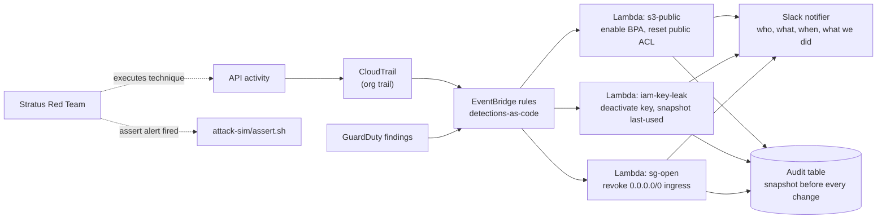
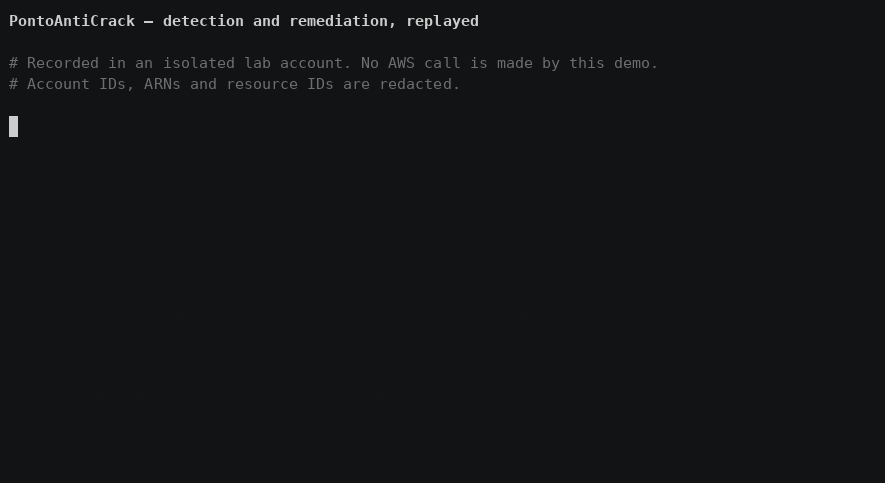

# PAC — Ponto Anti-Crack

Anti-cheat for cloud accounts. Same idea as VAC: the game keeps running, the cheater gets caught and kicked automatically.

Detection-as-code and automated remediation for AWS: CloudTrail → EventBridge → Lambda, with detections written as tested code and validated by running real attack techniques against the account.

> **Status: deployed to an isolated lab account, detonated, and measured.**
> Three detections with their remediations, wired to the organization CloudTrail
> through EventBridge. `sg-open` was executed with Stratus Red Team: live
> remediation closed a world-open SSH rule **5.97 seconds** after the attacker's
> API call. Fifteen of seventeen event fixtures are captured from real events,
> and the two that are not say so. `s3-public` and `iam-key-leak` have not been
> detonated, so no latency is claimed for them. Details in
> [What is actually proven](#what-is-actually-proven).
>
> Picking this up cold? Start at **[docs/PAChandoff.md](docs/PAChandoff.md)**.

---

## Why

Anyone can enable GuardDuty. The difference between a sysadmin who knows security and a security engineer is: the detection is code, it has tests, and it was proven by attacking the account — not by reading the docs.

## Architecture



Every detection runs through one pipeline, and the order is the security
property:

```
plan (read-only)  →  exclusion tag  →  SNAPSHOT TO AUDIT TABLE  →
circuit breaker   →  dry-run gate   →  apply  →  audit close  →  alert
```

Handlers implement `plan()` and `apply()` and nothing else. They never call the
audit log, the breaker, or the notifier, so they cannot get the order wrong.

Details and the decision record: [docs/architecture.md](docs/architecture.md).

## Detections

Each detection is a unit: EventBridge pattern, Lambda handler, its own scoped
IAM policy, a README, fixtures, and tests for both what it catches and what it
must not. `scripts/check-detection-coverage.sh` fails CI on a partial one.

| ID | Trigger | Remediation | ATT&CK | Unit tests | Detonated |
|----|---------|-------------|--------|-----------|-----------|
| [`s3-public`](remediations/s3_public/README.md) | ACL / policy / BPA change that can expose a bucket | Enable all four Block Public Access settings; reset a public ACL. **Policy retained as evidence.** | T1530, T1562.001 | ✅ | ❌ |
| [`iam-key-leak`](remediations/iam_key_leak/README.md) | GuardDuty finding ≥ MEDIUM on an access key | Capture `last-used`, set the key **Inactive, never deleted**. Root and temporary credentials escalate instead. | T1552.001, T1078.004 | ✅ | ❌ |
| [`sg-open`](remediations/sg_open/README.md) | Ingress authorised from `0.0.0.0/0` or `::/0`, in **either** CloudTrail encoding | Revoke **only** the world-open CIDRs on entries covering a sensitive port | T1190, T1021 | ✅ | ✅ 5.97 s |

Full mapping and the deliberate gaps: [docs/mitre-attack.md](docs/mitre-attack.md).

## What is actually proven

This matters more than the table above, so it gets its own section.

**Proven:** 185 unit tests. The patterns match the events their author intended
and reject the plausible-but-benign near-miss. The handlers make the right
call on a `moto`-backed AWS: a wildcard bucket policy scoped by
`aws:PrincipalOrgID` is left alone, 443-to-the-world is left alone, a rule
allowing both `10.0.0.0/8` and `0.0.0.0/0` on port 22 loses only the second, a
root credential finding is escalated and never acted on. The pipeline invariants
hold: the snapshot survives a failed remediation, dry-run changes nothing, the
circuit breaker stops a storm, an alert never carries credential material.

**Proven since 2026-07-30:**

- **The technique was detonated and the remediation ran.** Stratus Red Team
  opened SSH to the internet in the lab account; the rule was revoked **5.97
  seconds** after the attacker's API call, and the group's port 443 rule was
  left alone. `docs/evidence/time-to-remediate.md`.
- **Dry run means dry run.** The same technique in `dry_run = true` produced the
  same plan and the same snapshot and changed nothing — the port was still open
  afterwards.
- **The circuit breaker holds.** Seven world-open ports in eighty seconds: five
  actions, then four `BLOCKED` records and four ports deliberately left open.
- **Detonating found two defects that every green gate had missed**, both
  written up in `docs/evidence/detonation-sg-open.md`: a loop guard that read
  the caller-chosen session name, so any attacker passing
  `--role-session-name pac-…` was skipped; and a pattern that knew only one of
  the two CloudTrail encodings of `AuthorizeSecurityGroupIngress`, so an
  attacker using the legacy parameter form was invisible.

- **EventBridge itself agrees with every pattern on every fixture.** `make
  patterns` replays all seventeen through `aws events test-event-pattern`:
  seventeen agreements, zero disagreements; `docs/evidence/pattern-gate.md`.
  That closes the ADR-010 limitation: the local reimplementation in
  `tests/support/eventbridge.py` and the service return the same verdict on
  every one.
- **Fifteen of the seventeen fixtures are recorded events**, captured in the lab
  account from real API calls and sanitized;
  `docs/evidence/fixture-capture.md`. The assumption flagged as highest-risk
  held: CloudTrail emits `DeleteBucketPublicAccessBlock`, not the API's
  `DeletePublicAccessBlock`. Real events corrected five assumptions the tests
  around the patterns had encoded.

**Not proven:**

- **The root-credential fixture is still documentation-derived**, so
  `detections/iam-key-leak/metadata.yaml` still says
  `fixture_verified_against_live_event: false`. GuardDuty sample findings always
  carry a placeholder principal and none can be issued against the account root;
  capturing it honestly would mean manufacturing a root compromise.
- **The captured GuardDuty findings are service-generated samples.** Their type,
  severity and resource shape are exactly what GuardDuty emits, which is what
  the pattern reads, but no real compromise produced them.
- **Only one of the three techniques has been detonated.** `sg-open` was, and
  the 5.97 s above is its number. `s3-public` and `iam-key-leak` are wired,
  deployed and unit-tested, but no remediation of theirs has run against a real
  resource, so no latency is claimed for them and `docs/evidence/` carries no
  number for them.
- **The Slack path has never delivered an alert.** No webhook value exists in
  the lab's secret, so the notifier is unit-tested and never proven end to end.
  An absent secret is recorded as an undelivered alert rather than a failed
  remediation, and the audit record — not the chat message — is the system of
  record.
- **The false-positive rate is unknown.** Sixteen days of live operation in the
  lab produced zero new audit records, but an idle account generates no traffic
  to be wrong about. A week of real traffic under `dry_run = true` is what
  would settle it — step 10 of the handoff order.
- **There is no dead-man's-switch heartbeat** (threat R3). The existing alarms
  catch a *failing* detection; a *deleted* rule emits no metric at all, so
  nothing fires. This is the largest open gap.

The capture procedure for each fixture, and the order to apply and verify in, is
in [docs/session-report.md](docs/session-report.md).

## Threat model

Full version, including the four static-analysis suppressions and why each one
is or is not a real finding: [docs/threat-model.md](docs/threat-model.md).

| # | Threat | Control |
|---|--------|---------|
| R1 | Remediation Lambda over-privileged → escalation path | One role per detection, plus explicit `Deny` on the escalation primitives. `sg-open` cannot `Authorize*` anything; `iam-key-leak` cannot `CreateAccessKey` or `PassRole`; `s3-public` cannot read an object |
| R2 | Attacker triggers remediation as a DoS | Dry-run default, `pac:exclude` tag, per-detection circuit breaker **and** reserved concurrency, surgical revokes |
| R3 | Attacker disables the detection path | SCP on `pac-*`, DynamoDB deletion protection, alarms on errors / throttles / dead letters. **No heartbeat canary yet — the largest open gap** |
| R4 | Event schema drift → silent stop | Fixture tests on captured events, a coverage guard that requires a negative assertion, and `make patterns` replaying every fixture through EventBridge itself. **This threat was realised and caught by detonating, not by any of those** — see the threat model |
| R5 | Slack webhook leaked | Secrets Manager under a CMK, referenced by ARN, never in an env var or state; payloads scrubbed |
| R6 | Remediation destroys IR evidence | Snapshot before any change; no TTL on audit records; `dynamodb:DeleteItem` and `iam:DeleteAccessKey` denied by IAM |
| R7 | Alert fatigue | Conditional-write dedup with an exact window; benign outcomes do not alert |

## Validation

```bash
make test        # unit — fixtures + moto, no AWS account needed
make lint        # ruff, mypy, terraform fmt, trivy, checkov
make coverage    # fail if any detection is missing a piece of its unit
make validate    # terraform validate — no credentials needed
make attack      # live technique execution — ISOLATED ACCOUNT ONLY
```

`make attack` prints the resolved account ID and requires typed confirmation.
`attack-sim/assert.sh` additionally refuses to run unless
`STRATUS_LAB_ACCOUNT_ID` is exported and equals the caller identity — a stale
SSO session pointed at the wrong account is the realistic failure, and that is
what catches it.

## Layout

```
detections/<id>/       # EventBridge pattern + ATT&CK metadata + fixture provenance
remediations/<pkg>/    # handler.py, policy.json, README.md per detection
remediations/common/   # the pipeline: snapshot, breaker, dry-run, redaction
infra/                 # Terraform: rules, functions, per-detection roles, audit table
notifier/              # Slack formatting with context, deduplicated
attack-sim/            # Stratus scenarios + assertions (sg-open run; the other two written)
tests/                 # fixtures + unit tests + the local pattern evaluator
docs/                  # architecture ADRs, threat model, MITRE mapping, session report
```

## Cost

**Measured USD 1.40/month at rest** (August 2026 run rate, `awlz-lab`), against a
USD 20/month ceiling shared with [AwLZ](../AwLZ). The estimate was USD 2.35.

| Line | Estimated | Actual |
|---|---:|---:|
| KMS CMK — `alias/pac` | 1.00 | **1.00** |
| Secrets Manager — `pac/slack-webhook` | 0.40 | **0.40** |
| CloudWatch — 9 alarms | 0.90 | **0.00** |
| Logs, DynamoDB, Lambda, EventBridge, SQS, X-Ray | ~0.05 | ~0.00 |
| **Total** | **2.35** | **1.40** |

The two flat charges matched to the cent. The alarms did not bill at all:
**nine alarms sit inside CloudWatch's 10-alarm free tier, which the estimate
did not apply.** That makes the tenth alarm free and the eleventh a cliff — the
per-alarm cost is zero right up until it is USD 0.10 each, and adding one more
detection means three more alarms. Same effect confirmed independently in
AwLZ's management account, where the single break-glass alarm also billed zero.

Cross-checked against the first closed billing window on 2026-08-04; see
[AwLZ/docs/cost.md](../AwLZ/docs/cost.md) for the method, including the Cost
Explorer grouping that hides credits. Estimate breakdown retained in
[docs/session-report.md](docs/session-report.md).

**This footprint is deployed and running.** What was released in July was the
Lambda concurrency quota request, not the account — `awlz-lab` holds the CMK,
the secret, the three `pac-*` functions and their EventBridge targets, and has
run with `dry_run = false` since 2026-07-31. That is the state the 5.97 s was
measured in. Anything saying the lab "was released" means the quota effort.

## Demo



Recorded from the lab run of 2026-07-30: Stratus detonates, the Slack alert
arrives with context, the rule is revoked, and the timer is visible. The
terminal capture it was rendered from is `docs/img/demo.cast`.

## Roadmap

- [x] `infra/` — EventBridge + Lambda + per-detection roles + audit table in Terraform
- [x] `s3-public` detection + remediation + tests
- [x] `iam-key-leak` detection + remediation + tests
- [x] `sg-open` detection + remediation + tests
- [x] Slack notifier with context + dedup
- [x] Dry-run mode, tag-based exclusions, circuit breaker
- [x] Stratus Red Team scenarios wired to assertions (`sg-open` run four times)
- [x] MITRE ATT&CK mapping table
- [x] Apply to the lab account — deployed and wired to EventBridge
- [x] Capture real CloudTrail events and replace the fixtures — fifteen of
      seventeen; the two that stayed documentation-derived say why
- [x] Demo GIF
- [ ] Detonate `s3-public` and `iam-key-leak` and assert
- [ ] Time-to-remediate for those two — only `sg-open` is measured
- [ ] False-positive review after a week of real traffic
- [ ] Dead-man's-switch heartbeat (threat R3)
- [ ] `ModifySecurityGroupRules` rule for `sg-open`
